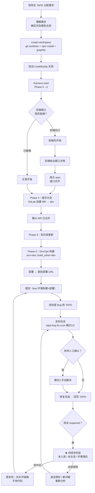
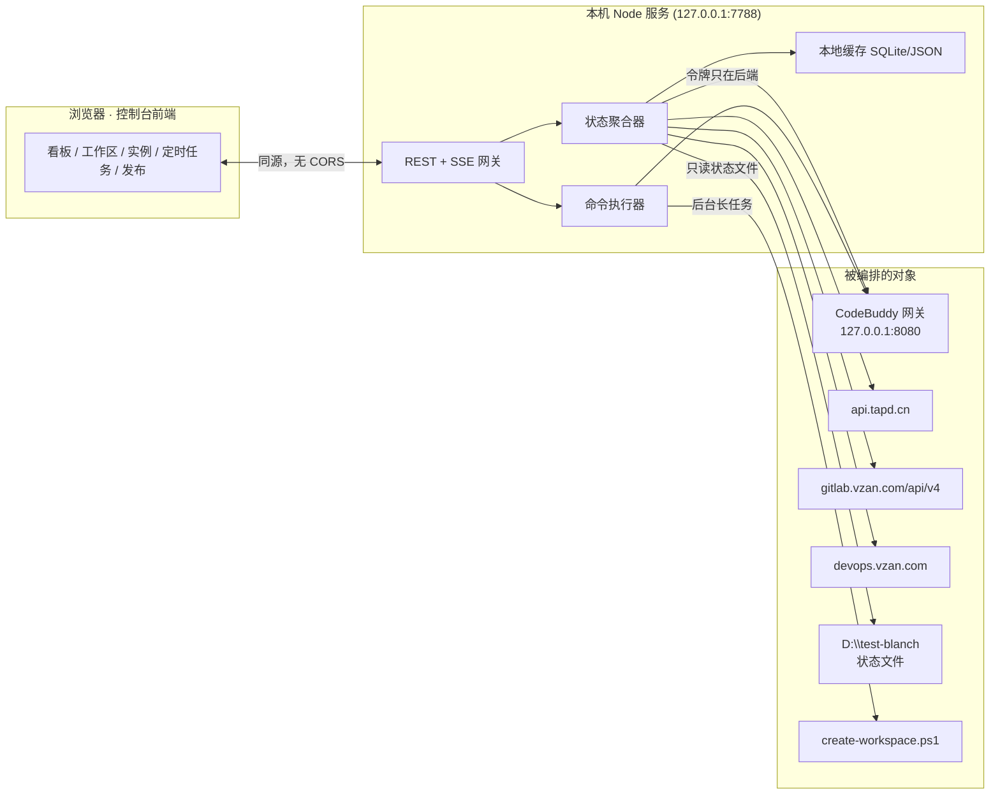

# DevTask Console · 需求规格说明

> 开发任务管理站点 —— 把 TAPD、git worktree、CodeBuddy 实例、Harness 流程、GitLab MR、DevOps 构建部署、Bug 定时修复串成一条可视可控的闭环流水线。
>
> **版本 v2.3** · 2026-11-12 · 单机自用 · 本地服务 + 网页控制台
> v2 变更：补入 GitLab 与 DevOps 两条通道，新增 M6 发布与部署模块，闭环「提测」环节。
> v2.1 变更：新增技术栈选型；按评审 H1 修正环境核对为「四信号判定」；H2 / H3 标为开工前阻塞项。
> **v2.2 变更（合并方案评审结论）**：① 交付顺序重排为「精简 MVP + 扩展」双轨，MVP 收敛到 20 条；② 新增 M7 收件箱模块与「聚合器先行」架构决策；③ Phase 4-6 期间发布写操作改为硬禁用；④ 补齐评审遗漏项 G1-G5（站点鉴权、失败恢复、磁盘成本、度量、统一快照时刻）；⑤ 新增第 11 节交互模式采纳决策摘要（29 条）。
> **v2.3 变更**：第 11 节由摘要升级为**完整决策记录**——29 条模式逐条补齐「结论 / 依据 / 落地 / 验收」（不抄类为「替代做法」），规格本身即可直接照着实现。内容与用户导出的决策快照一致，无改判。

---

## 0. 一句话定位

**它不是又一个项目管理工具，而是你现有工具链的「驾驶舱」。**

TAPD 仍是需求与缺陷的唯一信源，Harness 仍是开发流程的唯一状态机，tapd-bug-fix-cron 仍是修复流程的唯一信源，GitLab 与 DevOps 仍是代码与发布的唯一信源。
本站只做三件事：**聚合显示**（把散在六处的状态拼成一屏）、**代为执行**（把你现在手敲的命令变成按钮）、**守住边界**（不越过各工具已有的铁律）。

### 明确不做

| 不做 | 原因 |
|---|---|
| 自建需求/缺陷数据库并双向同步 | TAPD 是信源，双写必然打架。站点只缓存快照 |
| 自己实现一套开发流程状态机 | Harness 的 `e2e-state.json` 已经是了，重复造会互相污染 |
| 自己实现 Bug 分析修复逻辑 | `tapd-bug-fix-cron` 的三模式 + 锁 + 指纹已经很完整，站点只做入口与展示 |
| 代替 AI 改 `e2e-state.json` / `dev-pass.json` | Harness 铁律，站点同样遵守，只读 |
| 自动 git commit / push / 依赖变更 | 与现有安全边界一致，改动只留工作区 |
| **默认自动触发 pre / prod 发布** | 生产发布必须人来拍板，站点默认只开放 dev / test |
| **在 Harness Phase 4-6 期间触发构建 / 创建 MR** | v2.2 升级为硬规则：该区间站点发布写操作**直接禁用**，只读展示。避免与发布助手竞态、避免用错 env/buildOther 污染门控判定 |
| 多人权限体系 | 本期单机自用 |

---

## 1. 现状还原：你现在的工作流（v2 闭环版）



### 痛点（站点要解决的具体问题）

| # | 痛点 | 现在的做法 | 代价 |
|---|---|---|---|
| P1 | 不知道手上有几个需求、各到哪一步 | 翻 TAPD + 翻各 worktree 的 `e2e-state.json` | 上下文切换成本高，容易漏 |
| P2 | 建工作区要手敲 PowerShell、选仓库、等 5~10 分钟 | 命令行 + 人肉盯着 | 中断后不知道跑到哪一步 |
| P3 | 多个 CodeBuddy 实例分不清谁是谁 | 靠窗口标题和记忆 | 发错指令、看错输出 |
| P4 | 定时任务列表全是泛称，认不出属于哪个需求 | 已知坑 #28 | 改错任务、重复建任务 |
| P5 | 改轮询间隔要删了重建 | 手工 | 容易留下两条任务并行跑 |
| P6 | 「待人工确认」的 Bug 停下来后没有回流入口 | 模式 3 要在对话里手动跑 | 阻塞项积压，忘记处理 |
| P7 | 前端先行、后端接口后到，需要二次 start | 手动改 `story-input.json` + `--refresh-input` | 漏掉回填导致门控不生效 |
| P8 | 不知道定时任务上一轮到底干了什么 | 翻 `reports/*.md` | 出问题才发现 |
| **P9** | **MR 建了没合、卡在 Phase 4 不知道** | **翻 GitLab** | **流程停滞，误以为在开发** |
| **P10** | **构建成功没有、部署到哪个环境了** | **翻 DevOps 平台** | **提测时说不清版本** |
| **P11** | **reopened 到底是没修好还是环境没更新** | **人工比对 commit，最高频假复现** | **反复改代码做无用功** |
| **P12** | **多仓库需求要逐个构建再手工收集制品 URL 批量发布** | **手工复制 file_url** | **易漏应用、易发错环境** |
| **P13** | **DevOps 会话过期后 403，不知道是凭据问题还是平台挂了** | **看报错猜** | **排查浪费时间** |

---

## 2. 已核实的技术底座

> 以下路径与接口均已在本机核实，是实现时的直接依据。

### 2.1 本机目录约定

| 项 | 值 |
|---|---|
| 源仓库根 | `D:\workfile`（40+ 个 git 仓库，基线分支 `master`） |
| 工作区根 | `D:\test-blanch\<工作区名>\` |
| 分支命名 | `feat/<工作区名>` |
| 多根工作区文件 | `<工作区名>.code-workspace` |
| 工作区初始化脚本 | `~/.codebuddy/skills/create-workspace/scripts/create-workspace.ps1` |
| Harness 插件 | `~/.codebuddy/harness-marketplace/plugins/harness/` |
| Bug 修复 skill | `~/.codebuddy/skills/tapd-bug-fix-cron/` |
| MCP 配置 | `~/.codebuddy/mcp.json`（TAPD / GitLab / Devops / Figma / Playwright） |
| DevOps MCP 源码与文档 | `D:\other\devops\`（`PROJECT_INTRODUCTION.md` / `mcp-server.js` / `devops-api.js`） |

### 2.2 每个 worktree 内的状态文件（站点的主要数据源）

```
<worktree>/.codebuddy/
├── plans/<storyId>/
│   ├── e2e-state.json          # ★ 阶段状态：{storyId,title,phase,status,phases{}}
│   ├── story-input.json        # 原始输入（可写，非状态文件）
│   ├── requirement-analysis.md # Phase 0 产出
│   ├── acceptance-criteria.json
│   ├── task-dag.json / task-dag.md
│   ├── code-review.json        # Phase 3 产出
│   ├── open-questions.json     # 待确认项（confirmation 才是放行依据）
│   ├── scope-amendments.json   # 范围外改动
│   └── repos.json              # 多仓库映射（primary + repos）
├── scheduled_tasks.json        # ★ 定时任务 {tasks:[{id,cron,prompt,expiresAt,...}]}
├── scheduled_task_executions.json  # ★ 执行记录
├── bug-fix/                    # ★ Bug 工作台
│   ├── .lock                   # 执行锁 {roundId,startedAt,sessionHint}
│   ├── todo-list.md            # 跨轮进度唯一信源
│   ├── analysis/<bug_id>.md    # 含「## 待决问题」「## 人工确认结论」
│   ├── team/<bug_id>/
│   └── reports/<时间戳>.md
└── teams/
```

`e2e-state.json` 实测样例：

```json
{"storyId":"ZZ-GUARD-TEST","title":"guard test","phase":2,"status":"running",
 "phases":{"0_requirement":{"status":"completed"},"1_planning":{"status":"completed"},"2_development":{"status":"running"}}}
```

### 2.3 CodeBuddy HTTP API（能力已覆盖，无需自造）

启动：`codebuddy --serve --port 8080`
鉴权：每个请求必带 `X-CodeBuddy-Request: 1`；凭据用 `Authorization: Bearer <password>` 或 `X-Access-Token`，密码在 `~/.codebuddy/settings.json`。

| 站点动作 | 接口 |
|---|---|
| 列出实例 | `GET /api/v1/jobs?all=1&cwd=<path>` |
| 启动实例 | `POST /api/v1/jobs` `{prompt,cwd,name,agent,model,effort,permissionMode,bash,bgIsolation}` |
| 实例变更推送 | `GET /api/v1/jobs/events`（SSE：snapshot/added/changed/removed/keepalive） |
| 实时输出 | `GET /api/v1/jobs/:id/stream`（SSE，先回放尾部再跟随） |
| 历史对话 | `GET /api/v1/jobs/:id/transcript`（≤1000 行，不启动 worker） |
| 与实例对话 | `POST /api/v1/jobs/:id/reply` `{text,bash:false}` |
| 暂停 / 重启 / 删除 | `POST /jobs/:id/stop` / `POST /jobs/:id/respawn` / `DELETE /jobs/:id` |
| 重命名 | `PATCH /api/v1/jobs/:id/name` `{name}` |
| 可恢复会话 | `GET /jobs/resumable?cwd=` → `POST /jobs/resume` `{sessionId}` |
| 定时任务列表/新建 | `GET\|POST /api/v1/scheduled-tasks?sessionId=xxx` |
| **改间隔 / 启停** | `PATCH /api/v1/scheduled-tasks/:id` `{cron}` / `{enabled:false,sessionId}` |
| 删除任务 / 执行记录 | `DELETE /scheduled-tasks/:id` / `GET /scheduled-tasks/:id/executions` |
| 会话列表 | `GET /api/v1/sessions?cwd=*` |
| 内嵌终端 | `POST /api/v1/pty` → `GET /pty/:id/output`(SSE) → `POST /pty/:id/input/send` |
| 读文件 / 列目录 / 监听 | `GET /files/download?path=` / `POST /fs/list` / `POST /fs/watch`(SSE) |
| 健康与资源 | `GET /api/v1/health` / `GET /api/v1/metrics`（含 instances: cwd/pid/rssMib） |

**实例生命周期字段**：`state`(working/blocked/done/failed/stopped)、`status`(busy/waiting/idle/stopped)、`tempo`(active/idle/blocked)、`alive`、`settled`。
历史实例判定 = `settled===true && alive===false`。`webUrl` 仅在本机 loopback 有监听时非空。

### 2.4 TAPD 取数口径（必须照抄，已被实测验证）

```
结果 = get_related_bugs(story_id) 返回的 bug_id 集合
     ∩ current_owner 命中处理人
     ∩ status ∈ {new, reopened}
```

| 约束 | 说明 |
|---|---|
| `workspace_id` | 整数 `38260062`，传字符串报 must be integer |
| 两段式查询 | `get_related_bugs` 拿 id → `get_bug` 批量过滤，**只调两次** |
| 主+子需求 | id 用逗号拼接在同一字符串（实测 18+81→99 条） |
| `id` 位置 | 必须放进 `options`，写顶层报 additional properties |
| 参数命名 | 蛇形 `story_id`，不是 `storyId` |
| `owner` / `story_id`（get_bug 内） | **恒为空，禁用**；处理人用 `current_owner`（模糊匹配多人字段） |
| 状态值 | 必须英文 key：`new` / `reopened`；中文返回 0 条 |
| `limit` | 默认 10 会截断，传 ≥N（如 200）；用 `count` 判断真 0 条还是被截断 |
| `fields` | 不声明不返回，显式写 `id,title,status,current_owner,created,module,description` |
| `get_related_bugs` | 无 count、忽略 limit/page，数量 = `data.length`，一次全量 |
| 空数组 | 是「需求未关联缺陷」，不是失败，不重试、不用 workspace 级兜底 |

**其他可用工具**：`get_stories_or_tasks`、`get_iterations`、`get_release_info`、`get_bug_count`、`get_comments`、`get_workflows_status_map`。
**状态枚举**：`new` / `reopened` / `in_progress`(接受·处理) / `assigned` / `verified` / `resolved` / `postponed` / `rejected`。查询只认 `new`/`reopened`；回写只写 `in_progress`。

### 2.5 GitLab（`gitlab.vzan.com`）· v2 新增

MCP 名 `GitLab`（`npx gitlab-mcp`），API 基址 `https://gitlab.vzan.com/api/v4`，Personal Access Token 鉴权。

**已授权工具白名单**（`GITLAB_ALLOWED_TOOLS`，站点能力不得超出此范围）：

```
list_projects, search_repositories, get_project,
list_branches, get_branch, create_branch, get_branch_diffs,
list_merge_requests, get_merge_request, create_merge_request, merge_merge_request,
list_merge_request_changed_files, get_merge_request_approval_state,
create_tag, delete_tag, create_release, delete_release, update_release
```

**站点直连 REST 等价端点**：

| 用途 | 端点 |
|---|---|
| 找项目 | `GET /projects?search=<仓库名>` |
| 按分支找 MR | `GET /projects/:id/merge_requests?source_branch=feat/<工作区名>&state=all` |
| MR 详情 / 变更 / 审批 | `GET /projects/:id/merge_requests/:iid` / `/changes` / `/approvals` |
| 分支与提交 | `GET /projects/:id/repository/branches` / `/commits?ref_name=` |
| 判断提交是否在某分支 | `GET /projects/:id/repository/compare?from=<部署commit>&to=<修复commit>` |

**与 Harness 的关系**：Phase 4 = 提交开发分支 + 创建 MR（→ `dev`）+ **确认已合并**。
**关键关联键**：worktree 分支 `feat/<工作区名>` → MR 的 `source_branch`；目标分支固定 `dev`。

### 2.6 DevOps（`devops.vzan.com`）· v2 新增

MCP 名 `Devops_MCP`（`npx vzan-devops-mcp`，STDIO）。源码与完整文档在 `D:\other\devops\`。

**鉴权（重要）**：Cookie 会话制 —— `login_id` / `user` / `csrftoken` / `sessionid` 四个值拼成 Cookie，另需 `x-csrftoken` 头与 `Referer: https://devops.vzan.com/index.html`。
**这些值从浏览器开发者工具获取，会过期，过期表现为 HTTP 403。站点无法自动续期，必须提供刷新引导。**

**7 个工具与对应 REST**：

| 工具 | 入参 | REST | 用途 |
|---|---|---|---|
| `get-groups` | 无 | `GET /deploy/group` | 分组列表（如 `JenkinsFrontweb`） |
| `get-applications` | `group` | `GET /deploy/application?group=` | 分组下应用列表 |
| `get-branches` | `app` | `GET /deploy/branch?app=` | 分支列表，返回 `name`(origin/xxx)、`commit_id`、`last_commit_time` |
| `get-records` | `app`, `pageNo`, `pageSize` | `GET /deploy/build?app=&page_no=&page_size=` | 构建记录 + 当前状态 |
| `get-build-app` | `group`, `app`, `branch`, `env`, `buildType`, `buildOther` | `POST /deploy/build` | 触发构建 |
| `get-deploy-multiple` | `urls[]`, `env`, `force`, `timeout` | `POST /deploy/deploy_multiple` | 批量发布制品 |
| `get-build-stop` | `app` | `POST /deploy/build_stop` | 停止构建 |

**构建记录字段**（`detail[]` + `total`）：
`id`、`alias`(应用名)、`last_name`(操作人)、`build_date`、`commit_id`、`number`(构建号)、`branch`、`file_url`(制品地址)、`succeed`(1=成功)、`duration_time`(秒)。

**构建参数约定**：
- `branch` 格式必须是 `origin/<分支名>`
- `env` ∈ `test` / `dev` / `pre` / `prod`
- `buildType` 默认 `docker_build`；`buildOther` 为附加构建参数
- Harness Phase 6 固定用 `env=dev` + `build_other=dev`

**特殊分支逻辑（必须复刻，不能自己猜）**：应用 `live-h5-2` 会按环境自动选分支 ——
`test` → 找 `origin/test_*`；`dev` → 找 `origin/dev_*`；`pre` → 固定 `origin/pre2`。

**四类错误**：

| 错误 | 原因 | 站点应对 |
|---|---|---|
| `HTTP 403 Forbidden` | csrftoken / sessionid 过期 | 明确提示「DevOps 会话已过期」+ 刷新引导，不静默重试 |
| `fetch failed` / `ECONNREFUSED` | 网络或平台不可用 | 降级显示缓存 + 离线标识 |
| `Invalid input parameters` | 参数缺失或格式错 | 表单前置校验（branch 必须带 origin/ 前缀等） |
| **`上一任务尚未完成`** | 同应用有进行中构建 | 提交前检查，命中则给「查看进度 / 停止构建」入口 |

---

## 3. 架构方案



### 五条数据通道

| 通道 | 用途 | 刷新策略 |
|---|---|---|
| **TAPD（走 MCP，见 10.2）** | 需求、Bug 数量与明细、迭代、版本 | 手动 + 定时（默认 5 分钟）+ 进入页面 |
| **CodeBuddy API** | 实例列表/流/对话、定时任务 CRUD、终端 | SSE 长连 + 断线重连 + 30 秒轮询兜底 |
| **本地文件**（只读） | Harness 阶段、bug-fix todo/analysis/reports、锁 | `fs.watch` + 变更即推 |
| **GitLab 直连** · v2 | MR 状态、审批、变更文件、分支与提交比对 | 手动 + 进入需求详情时 + Phase 4 期间加密 |
| **DevOps 直连** · v2 | 应用/分支/构建记录、部署环境、制品 URL | 手动 + 构建中轮询（10 秒）+ 403 即停 |

### 关键架构决策

| # | 决策 | 理由 |
|---|---|---|
| A1 | **前端由本地 Node 服务同源提供** | 彻底绕开 CORS 与混合内容问题；令牌不下发浏览器 |
| A2 | **所有凭据只存后端**（运行时读取，不复制进代码库） | TAPD token、CodeBuddy 密码、GitLab PAT、DevOps 四件套均敏感 |
| A3 | **单网关多 cwd 优先**，多网关作为可选 | jobs 支持 `cwd`，一个 `--serve` 可管多工作区；若习惯每需求单开，则维护端口注册表 |
| A4 | **站点是编排层，不是状态机** | 状态以被编排方为准，缓存只用于展示与离线兜底 |
| A5 | **长任务一律后台 + 进度上报** | npm install 1~3 分钟/仓库、graphify 20 秒~5 分钟/仓库、构建数分钟，不能用默认 120 秒超时 |
| **A6** | **发布侧「读直连、写兜底」** | MR/构建状态直连 REST 实时读；创建 MR、触发构建默认由 Harness Phase 4/6 执行，站点手动触发需二次确认 |
| **A7** | **DevOps 凭据失效即熔断** | 403 后停止轮询并挂起该通道，避免用过期凭据反复打平台；等用户刷新后恢复 |
| **A8** | **聚合器先行，渲染层可抛弃** · v2.2 | 先把六源状态聚合成统一 `state.json`，这是真正的资产。看板 / 收件箱 / 流水线都是它的投影，形态选错也能换，核心投入不浪费 |
| **A9** | **收件箱为默认首屏** · v2.2 | 单人工具的核心问题是「现在该我做什么」。打开先看待决策项，需要全局时再切看板 |
| **A10** | **发布写操作在 Phase 4-6 硬禁用** · v2.2 | 不是「建议兜底」而是硬规则，避免与发布助手竞态、避免用错 env/buildOther 污染门控 |

---

## 4. 功能需求

编号规则：`模块-序号`。每条含**验收标准**，可直接当测试用例。

### M1 · 任务总览看板

| # | 需求 | 验收标准 |
|---|---|---|
| M1-1 | 需求列表 | 显示需求 ID、中文标题（含「【微赞+星享】」等前缀，不截断）、状态、优先级、处理人、迭代名 |
| M1-2 | Bug 数量徽标 | 三档：`待处理(new)` / `重新打开(reopened)` / `关联总数`；点击展开明细 |
| M1-3 | 需求链接直达 TAPD | 新标签打开，链接由 ID 拼接，不猜测 |
| M1-4 | 迭代与版本信息 | 迭代名称、起止日期、版本/发布计划；支持按迭代筛选分组 |
| M1-5 | **Harness 阶段进度条** | 读 `e2e-state.json` 渲染 Phase 0→6；当前 phase 高亮，`fix_loop` 显示回退，`blocked` 红色告警 |
| M1-6 | 四向关联 | 需求卡上直接看到：工作区路径、运行中实例数、cron 任务数与下次执行时间 |
| M1-7 | 未关联工作区给「去初始化」入口 | 一键跳 M2 并预填需求信息 |
| M1-8 | Bug 明细抽屉 | bug_id、标题、状态、处理人、创建时间、模块；`reopened` 打标并提示「需读评论」 |
| M1-9 | 本地修复进度对照 | 并排 TAPD 状态与 `todo-list.md` 本地状态；**本地「已完成」+ TAPD `new` 标为「已修复待流转」而非异常** |
| M1-10 | 全局搜索与筛选 | 按标题/ID、迭代、阶段、有无阻塞项筛选；`/` 聚焦 |
| M1-11 | 数据新鲜度标识 | 每块显示「更新于 x 秒前」+ 手动刷新；失败降级显示缓存并标注 |
| **M1-12** | **发布侧状态列** · v2 | 需求卡显示：MR 状态（未建/待合并/已合并）、最近构建号与结果、当前部署环境 |
| **M1-13** | **全链路一条链** · v2 | 需求 → 工作区 → Phase → MR → 构建 → 部署 → 提测 → Bug，一屏看完，断点标红 |
| **M1-14** | **链路断点告警** · v2.1 | 命中「未入库 / 未合流 / 环境滞后」任一信号时，在需求卡与 Bug 上同时打标（判定逻辑见第 6 节） |

### M2 · 工作区一键初始化

| # | 需求 | 验收标准 |
|---|---|---|
| M2-1 | 仓库候选清单 | 扫描 `D:\workfile` 下含 `.git` 的目录，列出全部候选 |
| M2-2 | **仓库必须人工勾选，禁止猜测** | 未勾选时「创建」禁用；不得按工作区名或需求标题推断 |
| M2-3 | 工作区名校验 | 只允许 ASCII 字母/数字/`.`/`_`/`-`；输入中文时当场给拼音/英文候选 |
| M2-4 | 参数可覆盖 | 分支名、基线分支、源根、目标根、跳过 install、跳过 graphify |
| M2-5 | DryRun 预演 | 展示将创建的 worktree、工作区文件、安装与建图动作 |
| M2-6 | **后台执行 + 实时日志** | 超时 ≥600000ms；分阶段进度：worktree → workspace 文件 → npm install → graphify |
| M2-7 | 逐仓库进度 | 每仓库独立三态 `ok / skip / fail`，`skip` 是正常结果 |
| M2-8 | 幂等重跑 | 已存在 worktree 跳过；`node_modules` 与 `.package-lock.json` 同时存在才跳过安装 |
| M2-9 | 结果复核表 | 直接展示 `BranchOk / InstallOk / GraphifyOk / Pass` |
| M2-10 | **副作用提示** | 列出各仓库 `git status --porcelain`，标注 lock 文件、`.eslintrc-auto-import.json`、husky hooks、`graphify-out/*` 属预期 |
| M2-11 | 不自动 git pull | 明示「基于创建时的本地 master」 |
| M2-12 | 一键打开 | 用 VS Code 打开 `.code-workspace` 或复制路径 |
| **M2-13** | **仓库 ↔ DevOps 应用映射** · v2 | 初始化时确认每个仓库对应的 DevOps 应用名与分组，写入映射表供 M6 使用；不一致时人工确认，不猜 |

### M3 · 实例管理与对话

| # | 需求 | 验收标准 |
|---|---|---|
| M3-1 | 实例列表 | `GET /jobs?all=1`，按工作区分组；显示 name、cwd、state、status、tempo、alive |
| M3-2 | **命名规范** | 默认名 = `需求中文标题 · <用途>`，杜绝「实例1/实例2」 |
| M3-3 | 启动实例 | 表单：cwd（必填）、prompt、agent、model、effort、permissionMode |
| M3-4 | 快捷启动模板 | ① `/harness start <storyId> "<标题>"` ② `/harness fixbugs` ③ 自由对话 |
| M3-5 | **实时输出** | SSE 渲染；断线自动重连并回放尾部，不丢行 |
| M3-6 | 历史回看 | `transcript`，未运行实例也能看历史（≤1000 行） |
| M3-7 | 与实例对话 | `POST /jobs/:id/reply`，多行输入 + 快捷指令，发送即回显 |
| M3-8 | 暂停/恢复/重启/删除 | stop / respawn / resume / delete；删除二次确认，`{deleted:false}` 如实展示原因 |
| M3-9 | **多实例不串线** | 每实例独立 SSE 与滚动位置；切换不影响其他流 |
| M3-10 | 阻塞态醒目提示 | `blocked` 高亮 + 顶部汇总「N 个实例等你回复」 |
| M3-11 | 内嵌终端（可选） | PTY，与实例对话区分，不混用 |
| M3-12 | **接口对齐二次启动** | 「补充接口文档 → 再次 start」：更新 `story-input.json` sources → `create-workflow.js <storyId> --refresh-input` → 再发 start。**必须提醒回填不可跳过** |
| M3-13 | Harness 状态只读 | 绝不写 `e2e-state.json` / `dev-pass.json`；推进一律通过给实例发指令 |
| M3-14 | 待确认项 surfaced | 读 `open-questions.json`，未 `confirmation` 的项上看板；**站点不替用户确认** |
| **M3-15** | **Phase 4-6 联动** · v2 | 进入 Phase 4 提示「MR 待创建/待合并」并给 GitLab 直达；Phase 6 展示构建进度与部署 URL |

### M4 · 定时任务管理

| # | 需求 | 验收标准 |
|---|---|---|
| M4-1 | 任务列表 | 合并 API 与本地 `scheduled_tasks.json`；**首行显示需求中文标题** |
| M4-2 | 模式标识 | 标注「模式1 只查」/「模式2 查+修」，模式2 用警示色 |
| M4-3 | **修改轮询间隔** | `PATCH {cron}`，不删不建；提供 20/30/60 分钟预设 |
| M4-4 | **cron 避开 0 分与 30 分** | 20 分钟→`7,27,47 * * * *`；30 分钟→`11,41 * * * *`；60 分钟→`13 * * * *`；自定义时拦截含 0/30 分 |
| M4-5 | 启用 / 暂停 | `PATCH {enabled:false,sessionId}`，暂停不删除 |
| M4-6 | **同一需求只保留一个任务** | 创建前检测同 storyId（跨模式去重），命中则展示旧任务 id/cron/prompt 前 50 字，确认后才删 |
| M4-7 | 创建任务 | 按模板**整段生成**，只替换占位，不局部 patch |
| M4-8 | **模式2 二次确认** | 明确告知「自动改代码 + 写 TAPD 评论 + 改缺陷状态」，勾选后才提交 |
| M4-9 | 持久化与有效期 | 默认 `durable:true`，30 天；显示到期时间 |
| M4-10 | `.gitignore` 提醒 | 提醒把 `.codebuddy/bug-fix/` 加入 gitignore，**不擅自修改** |
| M4-11 | 执行记录 | API + 本地 executions json；每轮时间、结果、runId |
| M4-12 | 轮次报告 | 直接渲染 `bug-fix/reports/<时间戳>.md` |
| M4-13 | **执行锁状态** | 显示 `.lock` 存在与否、roundId、持续时长；≥90 分钟标「陈旧锁」；**站点不主动删锁** |
| M4-14 | todo-list 可视化 | 解析成表格：bug_id / 本地状态 / 指纹 / 分类 / 解冻标记 |
| M4-15 | **模式3 解冻入口** | 列出「待人工确认/已转后端/待联调」→ 展示 analysis 的「## 待决问题」→ 答案录入 → 交实例执行模式3 |
| M4-16 | 解冻的边界 | 站点只收集答案并下发；**写回 analysis、改 todo、重算指纹由 skill 执行** |
| M4-17 | 锁冲突提示 | 锁 <90 分钟时解冻按钮禁用，提示 roundId |
| M4-18 | sessionId 绑定 | 为每个工作区维护会话映射，缺失时先 `GET /sessions?cwd=` 发现或创建 |

### M6 · 发布与部署 · v2 新增

| # | 需求 | 验收标准 |
|---|---|---|
| M6-1 | **MR 看板** | 按需求列出 MR（`source_branch=feat/<工作区名>` → `dev`），显示标题、状态、审批状态、变更文件数、链接 |
| M6-2 | MR 详情 | 变更文件清单、diff 摘要、审批人、是否已合并、合并时间 |
| M6-3 | **未合并阻断提示** | Phase 4 要求「确认已合并」才能进 Phase 5；未合并时需求卡标红并提示卡点 |
| M6-4 | 应用映射管理 | 仓库名 ↔ DevOps 应用名 ↔ 分组（默认 `JenkinsFrontweb`），可编辑，首次人工确认 |
| M6-5 | 分支列表 | `get-branches`，显示 `origin/xxx` + `commit_id` + 最后提交时间 |
| M6-6 | **构建记录** | `get-records` 分页；显示构建号、分支、commit、时间、成功与否、耗时、操作人、制品 URL |
| M6-7 | 触发构建（兜底） | 选 group/app/branch/env/buildType/buildOther → `POST /deploy/build`；**默认只开放 dev / test** |
| M6-8 | **pre / prod 护栏** | pre/prod 默认禁用，需显式解锁 + 二次确认 + 写审计；解锁状态不持久化，每次重新确认 |
| M6-9 | **构建冲突处理** | 提交前检查是否有进行中构建；命中「上一任务尚未完成」时给「查看进度 / 停止构建」入口，不盲目重试 |
| M6-10 | 停止构建 | `get-build-stop`，二次确认，显示结果 |
| M6-11 | **多应用批量发布** | 收集本需求各应用的 `file_url` → `get-deploy-multiple(urls, env, force, timeout)`；发布前逐项列出应用与制品，确认后才提交 |
| M6-12 | **★ 环境滞后四信号判定**（v2.1 修正） | 对 `reopened` 的 bug 顺序检查四个信号：① 工作区有未提交改动 → 判「未入库」；② MR 未合并 → 判「未合流」；③ 最近成功构建早于修复完成时间 → 判「环境滞后」；④ 三者皆否才进 A/B/C 真分析。**不做 commit 比对**——cron 修复硬禁 git 写，改动只留工作区，不存在「修复提交」 |
| M6-13 | 部署 URL 展示 | Phase 6 产出的部署地址挂在需求卡，一键打开对应环境 |
| M6-14 | **凭据过期处理** | 403 时明确提示「DevOps 会话已过期」，给出从浏览器开发者工具重新获取四个值的指引；**熔断该通道停止轮询**，刷新后恢复 |
| M6-15 | **特殊分支逻辑** | `live-h5-2` 按环境自动选分支（test→`origin/test_*`，dev→`origin/dev_*`，pre→`origin/pre2`）；站点复刻或透传，**不自己猜分支** |
| M6-16 | **写操作硬边界** · v2.2 升级 | **Harness Phase 4-6 期间，站点所有发布写操作（触发构建 / 创建 MR / 批量发布 / 停止构建）直接禁用**，按钮置灰并提示「Harness 正在执行 Phase N，由发布助手负责」。仅当流程处于该区间之外（如 cron 修完 bug 需重新部署）才开放手动兜底，且需二次确认 + 审计 |
| M6-17 | 提测动作 | 「提测」= 选 test 环境构建 + 部署 + 本地标记；**是否回写 TAPD 状态待确认（R4）**，默认只标记不写 |

### M5 · 支撑能力

| # | 需求 | 验收标准 |
|---|---|---|
| M5-1 | **连接自检页** | 逐项检测：CodeBuddy 网关可达/鉴权、TAPD token、**GitLab PAT**、**DevOps 会话（403 即判过期）**、工作区根可读写、脚本存在；每项给失败原因与修复建议 |
| M5-2 | 配置管理 | 网关地址端口、TAPD workspace_id、处理人昵称、源/目标根、默认轮询周期、**GitLab 地址与目标分支**、**DevOps 分组与默认环境**；凭据掩码显示 |
| M5-3 | **操作审计** | 所有写操作（建工作区、起实例、改 cron、删任务、下发指令、**触发构建、发布、停止构建**）记录时间、动作、参数、结果 |
| M5-4 | 危险操作护栏 | 站点自身不执行 git 写与依赖变更；bash 型 job 下发命令时做关键字提示（commit/push/rm/install） |
| M5-5 | 离线降级 | 任一通道不可达时显示缓存 + 明确「离线」标识，不白屏、不假报成功 |
| M5-6 | 键盘效率 | `/` 搜索、`⌘K` 命令面板（跳需求/起实例/改 cron/触发构建）、`Esc` 关闭抽屉 |
| **M5-7** | **站点自身鉴权** · v2.2（G1） | 后端聚合了 TAPD token + GitLab PAT + DevOps 会话 + CodeBuddy 密码，是本机最高权限点。绑 127.0.0.1 不等于安全——本机任何进程都能访问。启动时生成本地 token，前端首次访问注入，所有 `/api` 校验 |
| **M5-8** | **长任务失败恢复** · v2.2（G2） | 每个长任务（npm install / graphify / 构建）落盘进度文件（阶段、已完成仓库、时间戳）。进程重启或中断后可从断点续跑，而不是从头重来。这是个人工具的生死线 |
| **M5-9** | **磁盘占用可见** · v2.2（G3） | 看板显示各工作区占用（worktree + node_modules + graphify-out）。40+ 仓库 × N 个并行需求会迅速吃满磁盘。提供「归档 + 清理」引导，**不自动删除** |
| **M5-10** | **效果度量** · v2.2（G4） | 第一版就记录：需求分配→提测时长、reopened 中假复现占比、每周手动操作次数。没有基线就无法判断这个站点值不值得继续投入 |
| **M5-11** | **统一快照时刻** · v2.2（G5） | 五条通道刷新策略不同，看板会出现「TAPD 3 个 bug + 本地 5 个 + 构建 10 分钟前」的混合时刻。引入统一 `snapshotAt`，跨通道数据标注是否同一时刻，避免基于过期数据做决策 |

### M7 · 收件箱 · v2.2 新增（评审首推形态）

> 评审结论：单人工具的核心问题是「**现在该我做什么**」，不是「所有东西的状态」。全量看板大部分时候是噪音。
> 收件箱与看板共享同一份聚合快照，是同一数据的两种投影，不是两套数据。

| # | 需求 | 验收标准 |
|---|---|---|
| M7-1 | 只聚合需要人决策的事项 | 五类：实例 blocked、Bug 待人工确认、reopened 打回、MR 待合并、构建失败；外加 DevOps 凭据临期预警。其余一律不进 |
| M7-2 | 每项给出原因 + 一键动作 | 动作必须跳到**能真正解决它**的界面：去回复 / 回答并解冻 / 运行四信号 / 去看 MR / 看构建记录 |
| M7-3 | 处理即消失，可撤销 | 标记已处理后从列表移除，5 秒内可撤销；不做软删除堆积 |
| M7-4 | 空态有明确文案 | 清空后显示「现在没有需要你决策的事」，而不是空白或「暂无数据」 |
| M7-5 | 顶部四项统计 | 待决策数、高优先级数、实例运行中、今日已处理 |
| M7-6 | 与看板共享快照 | 切到收件箱不触发取数；同一需求在两个视图中的状态完全一致 |
| M7-7 | 作为默认首屏 | 打开站点先看到「该我做什么」，需要全局时再切看板 |

---

## 5. 数据模型

> 站点本地只存**缓存与关联关系**，不存业务真相。

| 实体 | 关键字段 | 来源 |
|---|---|---|
| `Requirement` | storyId, title, tapdUrl, status, priority, owner, iterationId, iterationName, releaseId, bugTotal, bugNew, bugReopened, fetchedAt | TAPD |
| `Iteration` | id, name, startdate, enddate, status | TAPD |
| `Bug` | id, title, status, current_owner, severity, created, module, storyId | TAPD |
| `BugLocal` | bugId, localStatus, fingerprint, category, unfreezeMark, blockedReason | `todo-list.md` |
| `Workspace` | name, path, repos[], branch, baseBranch, workspaceFile, initStatus{}, createdAt | 本地扫描 + 脚本 |
| `Instance` | jobId, name, cwd, state, status, tempo, alive, settled, sessionId, webUrl, storyId? | CodeBuddy |
| `CronTask` | id, sessionId, cron, promptFirstLine, mode, enabled, durable, expiresAt, storyId, nextRun | CodeBuddy + 本地 json |
| `Execution` | cronId, startedAt, finishedAt, result, runId, reportPath | executions + API |
| `PhaseState` | storyId, phase, status, phases{}, fixLoopCount | `e2e-state.json` |
| `LockState` | workspacePath, exists, roundId, startedAt, ageMinutes, stale | `.lock` |
| **`MergeRequest`** · v2 | iid, projectId, title, sourceBranch, targetBranch, state, mergeStatus, approvals, changesCount, webUrl, mergedAt | GitLab |
| **`BuildRecord`** · v2 | id, app, group, number, branch, commitId, buildDate, succeed, durationTime, fileUrl, operator | DevOps |
| **`Deployment`** · v2 | env, app, commitId, buildNumber, deployedAt, url | DevOps + Phase 6 产出 |
| **`AppMapping`** · v2 | repoName, devopsApp, group, specialBranchRule | 人工确认 + 配置 |
| `AuditLog` | ts, action, target, params, result | 站点自产 |
| **`Snapshot`** · v2.2 | snapshotAt, channels{id:{fetchedAt,ok,stale}}, reqs[], bugs[], jobs[], crons[], builds[], mrs[] | 聚合器产出，三视图共用 |
| **`JobProgress`** · v2.2 | jobId, kind(install/graphify/build), stage, doneRepos[], startedAt, updatedAt, resumable | 长任务落盘，支持断点续跑 |
| **`DiskUsage`** · v2.2 | workspacePath, worktreeBytes, nodeModulesBytes, graphifyBytes, totalBytes, scannedAt | 本地扫描 |
| **`Metric`** · v2.2 | storyId, assignedAt, testedAt, reopenCount, falseReopenCount, manualOps | 站点自产，用于效果度量 |

**关联主键**：`storyId` 是主线。工作区通过 `plans/<storyId>/` 反查，实例通过 `cwd` + 命名约定，cron 通过映射表，**MR 通过 `source_branch=feat/<工作区名>`，构建通过 `AppMapping`**。

> ⚠️ 两个脆弱关联：① cron 无 storyId 字段，只能靠 prompt 首行标题 → **必须维护 `storyId ↔ cronId` 映射表**；② 仓库名与 DevOps 应用名不一定一致 → **必须维护 `AppMapping`，首次人工确认**。

---

## 6. 状态机

### 需求生命周期（v2 闭环）

```
待理解 → 范围已确认 → 工作区就绪 → 开发中(Phase 0-3)
                                    ├─ 待接口对齐 ──┐
                                    └──────────────┘
       → MR待合并(Phase 4) → 知识库更新(Phase 5) → 构建部署(Phase 6)
       → 已提测 → Bug修复中 ⇄ 待人工确认 → 已完成 → 已归档
```

### Bug 双状态对照

| TAPD 状态 | 本地 todo 状态 | 站点显示 | 是否重做 |
|---|---|---|---|
| new | 待分析 | 待处理 | 是 |
| new | 进行中 | 修复中 | 指纹一致则继续 |
| new | 已完成 | **已修复待流转** | 否（正常现象） |
| new | 已转后端 / 待联调 | 已评论待后端 | 否 |
| **reopened** | 任意 | **测试打回 · 需读评论 + 环境核对** | **是，强制读评论** |
| 任意 | 待人工确认 | 阻塞 · 等你回答 | 否，走模式3 |

### ★ reopened 的四信号判定（v2.1 修正，解决最高频假复现）

> **为什么不用 commit 比对**：`tapd-bug-fix-cron` 硬禁 git 写操作，cron 修完的改动**只留工作区、未提交**，GitLab 上不存在「修复提交」。
> 真实链路是：cron 修复（未提交）→ 人工 commit/push → MR 合并 dev → 构建 → 部署 test。中间任何一步没做，环境就是旧的。

```
reopened
 ├ 第1步 强制读 TAPD 评论（不比对指纹，正文通常没变）
 ├ 第2步 信号① 工作区有未提交改动？   ← git status --porcelain
 │        是 → 【未入库】提示先提交，不改代码
 ├ 第3步 信号② MR 未合并？            ← GitLab MR state
 │        是 → 【未合流】提示先合并
 ├ 第4步 信号③ 最近成功构建早于修复完成时间？ ← DevOps get-records + reports 时间戳
 │        是 → 【环境滞后】提示重新构建部署
 └ 第5步 三个信号都排除 → A/B/C 真分析
          A 没修好（修复不完整/漏边界）
          B 新问题（原修复仍有效，建议测试拆单）
          C 需人工口径 → 登记待人工确认
```

**四个信号全部来自已有数据源，不需要新增接口，比 commit 比对更可靠也更简单。**

> ⚠️ 信号③ 的精度受 H2 限制：DevOps 只能查构建记录，查不到「当前部署版本」。构建成功 ≠ 已部署，所以该信号只能给「**疑似**环境滞后」，界面必须标注推断性质。

---

## 7. 非功能需求

| 类别 | 要求 |
|---|---|
| 安全 | 凭据只存后端，前端永不见明文；服务只绑 `127.0.0.1`；所有写操作二次确认；**pre/prod 默认禁用** |
| **站点鉴权** · v2.2 | 后端是本机最高权限聚合点，**必须有自己的本地 token**，不能因为绑了 loopback 就裸奔（G1） |
| 性能 | 看板首屏 <1s（走缓存）；SSE 推送 <1s；实例列表 100 个不卡 |
| 长任务 | npm install / graphify / 构建均后台执行，超时 ≥600s，进度可见、可中断、可幂等重跑 |
| **失败恢复** · v2.2 | 每个长任务落盘进度，进程重启/中断后**从断点续跑**；SSE 断线重连后回放尾部不丢行（G2） |
| 可靠性 | SSE 断线重连；文件监听失效降级轮询；**DevOps 403 熔断不空转**；任何外部失败都不假报成功 |
| **数据一致性** · v2.2 | 三视图共享同一 `snapshotAt`；跨通道数据标注是否同一时刻；切视图不重新取数（G5） |
| **磁盘** · v2.2 | 工作区占用可见；归档与清理分离，清理必须二次确认，不自动删（G3） |
| **度量** · v2.2 | 记录分配→提测时长、假复现占比、手动操作次数，用于判断工具是否真的省时间（G4） |
| 可观测 | 每块标注来源与更新时间；错误显示原始报错而非「操作失败」 |
| 可维护 | 查询口径、cron 规则、提示词模板、应用映射集中配置 |
| 边界 | 不写 Harness 状态文件；不删他人锁；不改指纹算法；不自动 git 写；**Phase 4-6 期间发布写操作硬禁用** |

---

## 8. 交付顺序 · v2.2 重排

> **评审结论**：原 S1 就要三条直连 + 本地扫描 + 14 条看板需求 + 环境核对，是 2-3 周的量。
> 个人工具最常见的死法是做到一半弃坑。因此改为**双轨**：先用约 20 条做出一个一周内能跑起来、立刻有用的最小闭环，再按依赖长肉。
> **核心原则：聚合器是资产，渲染层是可抛弃的。** 先把「聚合」这个真正的价值做出来，即使 UI 形态选错，核心投入也不浪费。

### 8.1 精简 MVP（约 20 条 · 目标一周）

| 阶段 | 内容 | 完成标志 |
|---|---|---|
| **A · 聚合器**（3-4 天） | ① Node 服务 + 本地 token 鉴权 + 连接自检页；② TAPD 走 MCP、GitLab/DevOps 走 REST，**全部只读**，含 403 熔断与离线降级；③ 本地状态扫描（`e2e-state.json` / `scheduled_tasks.json` / `bug-fix/`）+ chokidar；④ 产出统一快照 `state.json`（带 `snapshotAt`） | 一个 JSON 里能拿到六源状态；任一通道挂掉不影响其余 |
| **B · 收件箱 + 看板**（2-3 天） | ⑤ **M7 收件箱全部 7 条**（默认首屏）；⑥ M1 精简六条：需求列表、Bug 徽标、阶段进度条、四向关联、搜索筛选、新鲜度标识；⑦ **M6-12 四信号判定（只读）** | 打开就知道「该我做什么」；reopened 能自动判链路断点 |
| **C · 三个按钮**（1-2 天） | ⑧ 起实例 + 发指令（M3-3 / M3-7 精简版）；⑨ 改 cron 间隔 + 启停（M4-3/4/5，PATCH 不删建）；⑩ ⌘K 命令面板 | 高频操作不用离开网页；改间隔不删建任务 |

**MVP 明确不含**：工作区初始化表单、SSE 完整流、模式 3 解冻、发布写操作、审计、磁盘与度量。这些进扩展轨。

### 8.2 扩展轨（MVP 跑通后按依赖推进）

| 阶段 | 内容 | 前置 |
|---|---|---|
| **S3 实例管理完整** | SSE 实时流、多实例不串线、暂停/重启/恢复、接口对齐二次 start（M3 全部） | MVP-C |
| **S4 工作区初始化** | 脚本编排、后台长任务 + 断点续跑、结果复核表、应用映射（M2 全部） | MVP-A |
| **S5 定时任务完整** | 执行记录、todo-list 可视化、锁状态、模式 3 解冻（M4 全部） | **R18 实测通过** |
| **S6 发布写操作** | 触发构建、批量发布、停止构建、提测动作、prod 护栏（M6 剩余） | **R16 / R17 确认通过** |
| **S7 打磨** | 审计、磁盘占用、效果度量、失败恢复完善、离线降级、键盘导航 | 前面各阶段 |

> **为什么四信号判定放进 MVP**：它只读已有数据、不需新增接口，却是收益最高的一条——每次 reopened 都能少做一轮无用功。
>
> ⚠️ **前置阻塞**：S5 依赖 R18 实测结论，S6 依赖 R16 / R17 确认结论，未确认前不要动这两块。MVP 不受这三项阻塞，可以立即开工。

---

## 9. 风险与待确认

| # | 问题 | 影响 | 建议 |
|---|---|---|---|
| R1 | **网关拓扑**：每需求单开 CodeBuddy，还是一个 `--serve` 管多个？ | 决定要不要做端口注册表 | 建议单网关多 cwd；已习惯多实例则做网关发现 + 注册 |
| R2 | **sessionId 来源**：`scheduled-tasks` 必填 | 拿不到就建不了/改不了任务 | 先 `GET /sessions?cwd=` 发现；没有则起常驻会话并记住映射 |
| R3 | **TAPD token 权限**：能否读迭代/版本/评论 | 影响 M1-4、M4-15 | 自检页逐项探测，缺权限降级 |
| R4 | **提测是否写回 TAPD** | 现有 skill 明确不自动改状态 | 建议遵守：只做本地标记 + 提醒，状态由人在 TAPD 改 |
| R5 | **cron 与需求关联** | prompt 标题改了会失联 | 维护 `storyId ↔ cronId` 映射表 |
| R6 | **多仓库需求** | Harness 有 `repos.json`，工作区多根 | M2 支持多仓库勾选；M1 展示 primary + repos |
| R7 | **Figma / 原型链接** | `story-input.json` sources 决定是否触发硬门控 | M3-12 表单一并支持录入，避免漏填 |
| R8 | **worktree 清理** | 需求完成后目录堆积 | 本期只做归档标记，删除走脚本 + 二次确认 |
| **R9** | **DevOps 会话过期** · v2 | cookie/sessionid 失效即 403，无法自动续期 | 自检 + 熔断 + 刷新引导；这是运行期最常见的故障 |
| **R10** | **仓库名 ↔ 应用名不一致** · v2 | 构建/发布找错应用 | `AppMapping` 首次人工确认，不猜 |
| **R11** | **`live-h5-2` 特殊分支** · v2 | 自己猜分支会发错 | 复刻或透传 MCP 逻辑 |
| **R12** | **构建冲突「上一任务尚未完成」** · v2 | 盲目重试会一直失败 | 提交前检查 + stop 入口 |
| **R13** | **误发 prod** · v2 | 生产事故 | 默认禁用 + 显式解锁 + 二次确认 + 审计 |
| **R14** | **GitLab PAT 权限范围** · v2 | 白名单外能力不可用 | 站点能力不得超出 `GITLAB_ALLOWED_TOOLS`；直连同样受 PAT 权限约束 |
| **R15** | ~~修复提交如何确定~~ **已作废** · v2.1 | 原假设不成立：cron 硬禁 git 写，不存在修复提交 | 改为四信号判定（见第 6 节），无需确定修复提交 |
| **R16** 🔴 | **DevOps 查不到「当前部署版本」** · 阻塞 | 7 个工具只有构建记录，无部署状态查询；构建成功 ≠ 已部署 | **开工前确认**平台是否有部署记录接口。没有则信号③ 只能给「疑似环境滞后」，界面标注推断 |
| **R17** 🔴 | **dev 与 test 的关系未定义** · 阻塞 | Harness Phase 6 用 `env=dev`，而提测写的是 `test` | **开工前确认**：dev 即测试环境？还是两套？按应用不同？不确认则发布链按钮全错 |
| **R18** 🔴 | **多实例下 cron 的归属与存活** · 阻塞 | `scheduled-tasks` 绑定 sessionId，session 属于进程 | **开工前 30 分钟实测**：起两个实例各建一条 cron，关掉一个，看另一条是否仍跑。M4 的地基 |

> 🔴 **R16 / R17 / R18 是开工前阻塞项**，未确认前不要动 M4 与 M6 的实现。其余风险可在开发中逐步收敛。

---

## 10. 技术栈选型 · v2.1 新增

### 10.1 选型依据：本机环境与日常栈（已实测）

| 项 | 实测值 | 对选型的影响 |
|---|---|---|
| Node | **v22.20.0** | 内置 `fetch`、`node:sqlite`，无需额外依赖 |
| 包管理 | npm 10.9.3 / **pnpm 11.22.0** | 用 pnpm workspace 组织 monorepo |
| Shell | **PowerShell 7.6.10（pwsh）** | 与 `create-workspace.ps1` 要求一致 |
| 日常项目栈 | **Vue 3 + Vite + Element Plus + Pinia + vue-router + axios + echarts**（ESM，配 unplugin-auto-import） | **前端直接沿用，零学习成本** |
| 工具链运行时 | CodeBuddy / MCP / graphify 全是 Node | 后端选 Node，不引入第二套心智 |

**核心原则：贴着你已有的技能走，不推一套你还得学的。**

### 10.2 后端

| 层 | 选型 | 理由 |
|---|---|---|
| 运行时 | **Node 22 + TypeScript + ESM** | 与 CodeBuddy、MCP 同运行时；MCP 官方 SDK 的 TS 版最完整 |
| Web 框架 | **Fastify 5** | Schema 校验内置、SSE 直接写 `reply.raw`、pino 日志自带、TS 支持好 |
| MCP 客户端 | **`@modelcontextprotocol/sdk`**（StdioClientTransport） | 复用 `mcp.json` 里的 TAPD server，**凭据只有一份、查询口径天然一致** |
| HTTP 客户端 | **原生 fetch** | Node 22 内置，后端无需 axios |
| 文件监听 | **chokidar** | Windows 上比 `fs.watch` 可靠；监听 `e2e-state.json` / `todo-list.md` / `.lock` |
| 子进程 | **`node:child_process` spawn pwsh** | 跑 `create-workspace.ps1`，流式收 stdout，超时自管（≥600s） |
| 存储 | **v1：JSON 文件 + 内存 Map**；审计与历史用 **`node:sqlite`** | Node 22 自带 SQLite，零安装零运维；若嫌实验特性不稳，退 `better-sqlite3` |
| 校验 | **zod** | 与 MCP server 同一套；放 shared 包，前后端共用推导类型 |
| 日志 | **pino** | Fastify 默认，结构化便于排查 |
| 凭据 | **运行时读 `~/.codebuddy/mcp.json`** | 不复制到站点，避免双份管理与过期不同步 |
| 长任务 | **内存 job registry + 落盘进度 JSON** | 单用户单进程，不需要 Redis / BullMQ |

**取数通道分工（按评审 A1 修正）**：

| 通道 | 方式 | 理由 |
|---|---|---|
| TAPD | **走 MCP** | 口径最复杂（`owner` 恒空、`id` 放 options、limit 截断、状态英文 key），复用已踩平的 skill 口径 |
| GitLab | **直连 REST** | 接口标准简单，PAT 鉴权直接 |
| DevOps | **直连 REST** | 7 个端点明确，Cookie + CSRF 直接拼 |
| CodeBuddy | **直连网关 API** | 本来就是 HTTP |
| 本地文件 | **直接读 + chokidar** | 只读 |

### 10.3 前端

| 层 | 选型 | 理由 |
|---|---|---|
| 框架 | **Vue 3 + Vite + TypeScript** | 你的日常栈 |
| UI 组件 | **Element Plus** | 项目里已在用，组件肌肉记忆直接复用；暗色密集风格用 CSS 变量覆盖 |
| 状态 | **Pinia** | 已在用 |
| 路由 | **vue-router** | 页面少，常规用法 |
| 原子 CSS | **UnoCSS** | 密集自定义布局比 scoped CSS 快，与已有 auto-import 配置顺手 |
| 实时流 | **原生 EventSource** | 需带鉴权头时改用 fetch + ReadableStream |
| 长输出虚拟化 | **@tanstack/vue-virtual** | agent 输出上千行，不虚拟化会卡 |
| 终端 | **xterm.js + addon-fit** | 接 CodeBuddy PTY 接口 |
| Markdown | **markdown-it + shiki** | 渲染 bug-fix 的 reports / analysis |
| Diff | **diff2html** | 看 MR 变更，比 monaco 轻一个量级 |
| 图表 | **echarts** | 已在用，做度量趋势 |

### 10.4 工程组织

```
devtask-console/
├── apps/
│   ├── server/              # Fastify + MCP 客户端 + 状态聚合器 + 命令执行器
│   │   ├── src/
│   │   │   ├── channels/    # tapd(mcp) / gitlab(rest) / devops(rest) / codebuddy / localfs
│   │   │   ├── aggregator/  # 六处状态 → 统一快照
│   │   │   ├── executor/    # pwsh 长任务、job registry、进度落盘
│   │   │   └── routes/      # REST + SSE
│   │   └── package.json
│   └── web/                 # Vue3 + Vite
│       ├── src/
│       │   ├── views/       # 看板 / 需求详情 / 实例 / 定时任务 / 发布 / 自检
│       │   ├── components/
│       │   └── stores/      # Pinia
│       └── package.json
├── packages/
│   └── shared/              # zod schema → 推导 TS 类型，前后端契约单一信源
└── pnpm-workspace.yaml
```

| 项 | 约定 |
|---|---|
| 开发 | Vite dev server proxy `/api` → Fastify |
| 生产 | Vite build → Fastify 静态托管，**同源，无 CORS** |
| 端口 | **7788**（避开 CodeBuddy 的 8080 / 8321） |
| 绑定 | **仅 127.0.0.1** |
| 启动 | pm2（devops 项目已有 `start-pm2.bat`，熟）+ 开机自启 |
| 类型契约 | shared 包 zod schema 推导，前后端不各写一份 interface |

### 10.5 明确不选

| 不选 | 理由 |
|---|---|
| Python / Go 后端 | 工具链全是 Node，MCP 官方 TS SDK 最完整，换语言等于多养一套心智 |
| Nuxt / Next | 本地控制台不是内容站，SSR 零收益，纯 SPA + 本地 API 更简单 |
| Redis / BullMQ | 单用户单进程，内存 registry + 落盘进度足够，上消息队列是自找运维 |
| Electron | 浏览器够用，打包与更新成本无收益。**除非**要托盘通知——那时考虑 Tauri |
| Postgres / MySQL | 单机自用，SQLite 零运维 |
| axios（后端） | Node 22 原生 fetch 够用 |
| monaco-editor | 只读 diff 用 diff2html 就够，monaco 太重 |

### 10.6 安全补充（按评审 G1）

站点后端聚合了 TAPD token + GitLab PAT + DevOps 会话 + CodeBuddy 密码，**等于本机最高权限点**。绑 127.0.0.1 不等于安全——本机任何进程都能访问。

| 措施 | 说明 |
|---|---|
| 站点自身鉴权 | 启动时生成本地 token，前端首次访问注入；所有 `/api` 校验 |
| 凭据不落前端 | 前端只见掩码，明文永不下发 |
| 凭据存储 | 优先运行时读 `mcp.json`；站点自有配置加密存储 |
| 写操作审计 | 全部落 SQLite，含参数与结果 |
| pre/prod 护栏 | 默认禁用，显式解锁 + 二次确认，解锁状态不持久化 |

### 10.7 备选：零后端方案（保留可能性）

CodeBuddy 网关已提供 `jobs` / `scheduled-tasks` / `sessions` / `fs` / `pty` / `process` 全套——**它本身就是个后端**。

极端方案：纯静态前端直连网关，TAPD/GitLab/DevOps 通过起 job 调 MCP 查询。**零后端代码。**

代价：需配 `CODEBUDDY_CODE_CORS_ORIGINS`、密码进浏览器、查询有延迟与额度消耗。

**当前不采用**（凭据暴露与延迟是硬伤），但保留判断标准：**如果后续发现后端大部分代码只是在转发网关接口，就该重新考虑这个方案。**

---

## 11. 交互模式采纳决策 · v2.3 升级为完整记录

> 来源：对 23 组协作与流程产品的交互调研，逐条放到本项目真实约束下重判，共 **29 条模式**。
> 本节为**完整决策记录**（含落地方式与验收标准），可直接照着实现，无需再翻决策板。
> 可交互决策板见 `outputs/devtask-pattern-adoption/`；用户导出的决策快照见 `Downloads/DevTask-Console-交互采纳决策.md`（2026-11-12 20:54，与本文一致，无改判）。
> 结论：**13 条直接采纳 · 10 条改造后采纳 · 6 条明确不抄**，其中 P0 共 16 项。

### 11.1 直接采纳（13）

#### 命令面板 ⌘K
`P0 · 全局 · 成本 M` · 来源：Linear / Notion / ClickUp
- **结论**：我们要跨六个数据源跳转，搜索是唯一低成本的统一入口，优先级最高。
- **依据**：需求在 TAPD、阶段在本地文件、实例在 CodeBuddy、cron 在网关、MR 在 GitLab、构建在 DevOps。靠点击导航找东西，跨源跳转成本极高。命令面板把「功能多」从界面搬进搜索框，主界面因此能保持极简。
- **落地**：索引 reqs / jobs / crons / builds / mrs 五类对象 + 屏幕跳转 + 动作命令。模糊匹配（子序列即可），结果右侧标注类型与所属需求，无输入时置顶最近使用。动作命令直接执行，例如「把惠康的巡检改成 30 分钟」→ PATCH scheduled-tasks。
- **验收**：100ms 内出现；输入即过滤不卡顿；↑↓ 选择、↵ 执行、Esc 关闭；执行完不需要回到鼠标。

#### 渐进披露 + 侧滑详情
`P0 · M1 看板 · 成本 M` · 来源：Linear / monday.com
- **结论**：列表只留决策必需字段，六源详情收进侧滑抽屉，不打断空间上下文。
- **依据**：一个需求要展示的信息横跨六个源，全铺在卡片上必然过载。侧滑而非整页跳转，关掉后滚动位置和选中行都还在。
- **落地**：卡片只留标题、阶段进度条、Bug 徽标（new/reopened/待确认）、工作区、MR/CI/实例/cron 四个小角标。点开抽屉聚合六源详情 + 关联 Bug 列表 + 快捷动作。行内操作按钮悬停才出现，且隐藏时 `pointer-events:none`。
- **验收**：抽屉打开不改变列表滚动位置；Esc 关闭并把焦点还给触发行；抽屉内可直接跳转到流水线/实例/发布。

#### 骨架屏替代转圈
`P0 · 全局 · 成本 S` · 来源：Linear / ClickUp
- **结论**：五条通道延迟不一，骨架屏给出内容形状与心理预期，比转圈更耐等。
- **依据**：TAPD 走 MCP 有进程延迟、DevOps 会话可能 403、本地文件很快。混用转圈会让整个看板看起来「都在等」。
- **落地**：首屏与切换筛选时用卡片形状骨架；单通道慢时只骨架该区块，其余照常显示。超过 2 秒追加「仍在拉取 DevOps…」并提供取消；失败降级为缓存 + 离线标识，绝不白屏。
- **验收**：骨架形状与真实卡片一致；超 2 秒有文字进度与取消入口；任何通道失败都不导致整页空白。

#### 暗色默认 + 4px 高密度网格
`P0 · 全局 · 成本 M` · 来源：Linear
- **结论**：开发者长时间盯屏，且要与 CodeBuddy、终端视觉连成一片。
- **依据**：我们的控制台夹在 CodeBuddy 与终端之间，亮色会造成视觉割裂。高密度靠 4px 网格与对齐实现，不是靠挤。
- **落地**：暗色默认、亮色可切换且状态色在两套主题下分别调对比度。4px 间距基数、13px 正文、等宽字体用于 ID/cron/commit。只有状态与告警给饱和色，其余用中性色，靠字重与透明度分层。
- **验收**：两套主题下所有文字达到可读对比度；状态色在色觉障碍模拟下仍可区分（颜色+图标+文字至少两种编码）。

#### 多视图共享同一份数据
`P0 · 全局 · 成本 L` · 来源：Notion / Airtable / 飞书项目
- **结论**：看板、流水线、收件箱是同一份状态的三种投影，切视图不重新取数。
- **依据**：这是参考产品里最值得抄的一条架构级决策。三个视图各拉各的，必然出现「看板说 3 个 bug、收件箱说 5 个」的时刻错位。
- **落地**：后端聚合器产出统一快照 `state.json`（带 `snapshotAt`），前端三个视图都读它。切视图只做渲染切换，不触发重新拉取；刷新是显式动作，刷新后三个视图同步更新。
- **验收**：切换视图无网络请求；同一需求在三个视图中的阶段/Bug 数完全一致；快照时刻在界面上可见。

#### 收件箱：只放待决策项
`P0 · M7 收件箱 · 成本 M` · 来源：Basecamp 的克制 + 单人场景推导
- **结论**：单人工具的核心问题是「现在该我做什么」，不是「所有东西的状态」。
- **依据**：全量看板大部分时候是噪音。真正需要人介入的只有五类：实例 blocked、bug 待人工确认、reopened 打回、MR 待合并、构建失败/凭据过期。
- **落地**：只聚合这五类 + 凭据预警，每项给出原因与一键动作。处理完即从列表消失，可撤销。顶部四个统计：待决策数、高优先级、实例运行中、今日已处理。
- **验收**：清空后显示明确的空态文案；每项都能一键跳到能真正解决它的界面；标记已处理可撤销。

#### 执行锁与跨轮幂等可视化
`P0 · M4 定时 · 成本 S` · 来源：自有 tapd-bug-fix-cron 机制
- **结论**：把 `.lock` 与 `todo-list` 的隐藏机制搬到台面上，否则你永远不知道任务为什么跳过。
- **依据**：已知坑里一半是「为什么这轮没修」——锁没释放、指纹一致被跳过、本地已完成但 TAPD 还是 new。可视化能省掉大量翻文件。
- **落地**：任务行显示锁状态（roundId + 已持续分钟数），≥90 分钟标「陈旧锁」并提示可接管，但站点不主动删锁。todo-list 解析成表格显示本地状态 + 指纹 + 分类。本地「已完成」+ TAPD new 标注「已修复待流转（正常）」。
- **验收**：锁存在时解冻按钮禁用并显示 roundId；reopened 行无条件标红提示需读评论；正常跳过与异常跳过在文案上可区分。

#### 四信号判定面板
`P0 · M6 发布 · 成本 M` · 来源：自有增量 · 借鉴 CI 诊断视图
- **结论**：整个控制台收益最高的一条：把最高频的假复现变成一次自动判定。
- **依据**：已知坑 #27 把「测试环境没更新」标为最高频假复现。原方案想用 commit 比对，但 cron 硬禁 git 写、改动只留工作区，根本不存在修复提交。改成四信号顺序排查后，全部数据都是现成的。
- **落地**：reopened 触发 → ① 强制读 TAPD 评论 ② git status 有未提交改动？判「未入库」 ③ MR 未合并？判「未合流」 ④ 最近成功构建早于修复完成？判「环境滞后」。任一命中即给结论与下一步动作，不改代码；三个都排除才进 A/B/C 真分析。
- **验收**：逐条动画式检查并显示每条的数据来源；命中时给出明确处置建议；信号③ 因 DevOps 无部署查询接口，必须标注推断性质，不得表述为确定结论。

#### 聚合视图不做二次录入
`P0 · 全局 · 成本 S` · 来源：ONES
- **结论**：给管理层/自己一层聚合视图，但底层永远是同一份工作项。
- **依据**：一旦允许在站点里手动改 Bug 数或阶段，就会与 TAPD / Harness 分叉，之后所有判断都不可信。
- **落地**：所有业务字段只读聚合，本地只存三类自有数据：关联映射（storyId↔cronId、仓库↔DevOps应用）、用户偏好（视图/排序/改判）、操作审计。任何业务字段的修改都必须回到源系统。
- **验收**：代码里不存在写 TAPD 业务字段或 `e2e-state.json` 的路径；本地存储只含映射、偏好、审计三类。

#### 统一导航 + 全局搜索
`P0 · 全局 · 成本 S` · 来源：Huly
- **结论**：多形态合一时先统一导航与搜索，其余界面各自保留习惯。
- **依据**：七个屏幕来自六个系统，如果每个屏幕各造一套导航，切换成本会抵消聚合带来的收益。
- **落地**：左侧固定 rail 七项 + 数字键 1-7 直达；顶部面包屑显示当前屏幕与关键统计；⌘K 跨屏幕跳转。各屏幕内部布局按自身需要设计，不强求一致。
- **验收**：任意屏幕两次按键内可达另一屏幕；rail 常驻不随滚动消失；当前屏幕在导航上有明确标识。

#### 保存视图
`P1 · M1 看板 · 成本 S` · 来源：Notion / Airtable
- **结论**：把常用筛选组合存成一键视图，例如「我的阻塞项」「本周提测」。
- **依据**：每天关心的切面是固定的几个，每次重新点筛选是重复劳动。低成本高回报。
- **落地**：当前筛选（阶段 + 关键词 + 排序）可保存为命名视图，显示为一排 chip。内置三个常用视图，用户可新增。视图只存偏好，不复制数据。
- **验收**：保存后一键恢复完整筛选组合；视图切换不触发取数；可删除自建视图。

#### 行内编辑
`P1 · M4 定时 · 成本 S` · 来源：Linear
- **结论**：改 cron 间隔、改实例名这类高频小改动，不该开弹窗。
- **依据**：改轮询间隔是最高频的操作之一，如果每次都弹表单，人会懒得改，进而留着不合适的周期跑。
- **落地**：间隔用行内下拉（20/30/60），选中即 PATCH 并乐观更新 cron 字符串；实例名点击即变输入框，失焦提交。所有行内编辑都走乐观更新 + 撤销。
- **验收**：从点击到看到新值 <100ms；失败回滚并显示原始错误；不需要打开任何弹窗。

#### g + 字母 键盘导航
`P1 · 全局 · 成本 S` · 来源：Linear
- **结论**：vim 式双键导航，让常驻用户彻底离开鼠标。
- **依据**：使用者是开发者，本来就有终端与编辑器的快捷键肌肉记忆，迁移成本几乎为零。
- **落地**：`g d` 看板 / `g i` 收件箱 / `g p` 流水线 / `g c` 实例 / `g t` 定时 / `g r` 发布 / `g w` 工作区；`/` 聚焦搜索；`T` 切主题；`Esc` 关闭浮层。命令面板里显示这些快捷键，形成学习路径。
- **验收**：输入框内不触发；快捷键在命令面板与页脚可见；不与浏览器默认冲突。

### 11.2 改造后采纳（10）—— 照搬会出事

#### 乐观更新 + 撤销
`P0 · 全局 · 成本 M` · 来源：Linear / Things 3
- **结论**：可逆操作全部乐观更新；但触发构建、发布、建模式2任务绝不能乐观。
- **依据**：Linear 的前提是「操作几乎不会失败且可回滚」。我们一半操作满足，另一半是不可回滚的外部副作用——构建一旦提交就会真的跑，TAPD 评论一旦写出就会被同事看到。
- **落地**：分两类封装。① 可逆类（PATCH cron、enabled 开关、归档需求、标记 bug 已处理、改实例名）本地先改 → 后台提交 → 失败回滚并显示原始错误 + 5 秒撤销吐司。② 不可逆类（触发构建、批量发布、删除 cron、创建模式2任务）必须等真实回执，按钮进入 loading 且禁用重复点击。
- **验收**：可逆操作界面响应 <50ms 且失败能回滚；不可逆操作在回执前不得显示成功；两类在代码里用不同封装，避免误用。

#### 状态药丸单击切换
`P0 · M1 看板 · 成本 S` · 来源：monday.com / Airtable
- **结论**：学它的形式，但不能学它的自由循环——我们的状态受 Harness 状态机约束。
- **依据**：monday 的状态是自定义枚举、无强约束。我们不行：Harness 相位由 dispatch.js 判定，TAPD 回写只允许 `in_progress`，Bug 本地状态还参与跨轮幂等。乱循环会破坏门控与去重。
- **落地**：药丸保留彩色 + 单击直达的手感，但点击后弹出的是「当前合法目标状态」列表（由状态机计算），不是无限循环。Harness 相位药丸完全只读，点击只跳转到流水线对应节点。
- **验收**：任何状态变更都经过合法性校验；Harness 相位不可通过 UI 直接改写；非法目标态不出现在选项里。

#### 节点流可视化 + 条件裁剪
`P0 · 流水线 · 成本 M` · 来源：飞书项目 Meego
- **结论**：把流程图画成主界面这一招直接学，但我们只展示不配置。
- **依据**：Harness 七相位天然就是节点流，而且比飞书项目更严格（dev-pass、门控、fix-loop）。但配置权在 Harness，站点不能抢。
- **落地**：读 `e2e-state.json` 渲染九节点流水线（P0-P6 + 提测 + Bug 修复）。当前节点高亮、fix_loop 标 amber、blocked 标红。被条件裁剪的节点灰显「已裁剪」。点节点展示负责角色、关键产出物、门控条件、状态文件路径。
- **验收**：节点状态与 `e2e-state.json` 完全一致；点节点能看到产出物与门控；站点没有任何写入该文件的代码路径。

#### 自动化写成自然语言句子
`P0 · M4 定时 · 成本 M` · 来源：Asana Rules
- **结论**：把 cron 的 prompt 翻译成「当…且…则…」，让人能审计这条任务到底会干什么。
- **依据**：定时任务 prompt 长达数百字，列表里只显示开头几十字——这正是已知坑 #28。我们需要的是让自己三个月后还能看懂这条任务会做什么。
- **落地**：解析模式（1 只查 / 2 查+修）+ 查询口径（get_related_bugs → get_bug，current_owner，new|reopened）+ 副作用，渲染成三行句子卡：「每 60 分钟，查该需求关联缺陷中处理人是我且状态为 new/reopened 的」「模式2：命中后自动分析、分类、修复、验收」「副作用：改工作区代码 + 写 TAPD 评论 + 改状态为 in_progress」。模式2 整卡用警示色。
- **验收**：不读 prompt 原文也能说清触发条件、动作与副作用；模式2 的副作用在建任务前必须显式确认。

#### 字段类型驱动控件与护栏
`P0 · M6 发布 · 成本 S` · 来源：Airtable
- **结论**：环境字段的类型直接决定控件形态：dev/test 普通，pre/prod 带锁。
- **依据**：env 字段应该由类型驱动护栏，而不是靠人记得别点 prod。分支字段必须带 `origin/` 前缀，也应该由控件保证而不是靠校验报错。
- **落地**：env 渲染为分段控件，pre/prod 默认带锁图标且不可选，解锁需二次确认且不持久化。branch 下拉只给 get-branches 返回的真实分支（已带 origin/），不允许自由输入。`live-h5-2` 应用自动按环境选分支并标注「已按特殊规则选择」。
- **验收**：未解锁时无法选中 pre/prod；分支值一定来自真实列表；特殊应用的分支规则可见且不可被手动覆盖成错误值。

#### 撤销优先于确认的边界
`P0 · 全局 · 成本 S` · 来源：Linear（反例学习）
- **结论**：Linear 说危险操作用撤销不用确认——这条在我们这里必须划出例外清单。
- **依据**：直接照搬会出事。我们的发布、TAPD 评论、模式2 建任务都是对外部系统的不可逆写入。同事会看到机器人写的评论，生产发布会真的上线。
- **落地**：明确例外清单：触发构建、批量发布（尤其 pre/prod）、删除 cron、创建模式2 任务、停止他人正在跑的构建 —— 一律二次确认 + 写审计。其余操作走撤销。确认弹窗要写清具体副作用，不是笼统的「确定吗」。
- **验收**：例外清单内操作没有确认就无法提交；确认文案列出具体副作用；所有确认过的写操作可在审计里回溯。

#### 看板拖拽
`P1 · M1 看板 · 成本 S` · 来源：Trello
- **结论**：拖拽只用于手动排序与分组，绝不用于改阶段。
- **依据**：Trello 的拖拽即流转成立，是因为它的列就是用户自定义状态。我们的阶段由 Harness 决定，拖卡片改阶段等于伪造状态。
- **落地**：卡片可拖拽调整顺序，落点虚线高亮，松手后自动切到「手动排序」。提供键盘替代：选中卡片后 ←→ 移动。阶段变更一律走状态机，不走拖拽。
- **验收**：拖拽只改 order 不改 phase；有明确落点提示；键盘可完成同样操作。

#### 快捷指令模板
`P1 · M3 实例 · 成本 S` · 来源：Things 3 魔法命令 / 滴答清单
- **结论**：学它的「少点几下」，但用在给实例发指令，而不是建需求。
- **依据**：我们不建需求（需求来自 TAPD），但给实例发指令是高频动作，且有几条是固定套路：start、接口对齐二次 start、跑一次巡检、汇报进度。
- **落地**：输入框上方一排快捷 chip，点击填入模板。特别是「接口对齐」要自动带上完整三步：更新 `story-input.json` → `create-workflow.js --refresh-input` → 再 start，并提示回填不可跳过。
- **验收**：快捷指令覆盖四个高频场景；接口对齐模板包含 `--refresh-input` 步骤且有明确提示。

#### 在制品限制 WIP
`P1 · M3 实例 · 成本 S` · 来源：PingCode / Worktile 泳道看板
- **结论**：限制的不是看板列，而是并行运行的 CodeBuddy 实例数。
- **依据**：我们的瓶颈不是任务列，而是本机资源——每个实例都在跑 AI、每个 worktree 都有 node_modules。并行开太多会互相拖慢，且注意力被切碎。
- **落地**：顶部显示「3/4 实例运行中」，阈值可配置。超限时告警并显示 `/metrics` 的 CPU 与内存占用。新建实例时若已达上限，提示先停一个而不是直接拒绝。
- **验收**：运行数与阈值实时可见；超限有明确视觉告警；资源数据来自网关 `/metrics` 而非估算。

#### Hill Chart 表达模糊进度
`P2 · M1 看板 · 成本 M` · 来源：Basecamp
- **结论**：用它表达「需求口径想清楚了没」，而不是完成百分比。
- **依据**：我们正好有一个没法用百分比衡量的量：`open-questions.json` 里未确认的口径问题。问题多的需求看着在开发，其实随时会返工。
- **落地**：需求卡上一条小爬坡：左半坡代表待确认问题多（还在想清楚），右半坡代表口径已定在收尾。数据来自 `open-questions.json` 的 confirmation 字段，不是估算。站点不替用户确认。
- **验收**：爬坡位置由未确认项数量驱动；点击可看到具体问题清单；确认动作只能由用户在源流程完成。

### 11.3 明确不抄（6）—— 拒绝也是设计决策

#### 完成音效与彩带动效
`P2 · 全局 · 成本 S` · 来源：Amie
- **结论**：常驻工作台不需要声音，正反馈保留视觉即可。
- **依据**：Amie 的音效在个人待办里讨喜，因为完成是人主动触发的高光时刻。我们的控制台长时间常驻，构建完成、巡检结束可能在你根本没看屏幕时发生，声音会变成噪音；而且很多完成事件一小时发生三次。
- **替代**：保留轻量视觉反馈——构建成功只更新角标与状态色；需要提醒时走可选的系统通知，默认关闭。

#### 每日计划仪式
`P2 · 全局 · 成本 M` · 来源：Sunsama
- **结论**：你的任务由领导分配、由 TAPD 驱动，不是自己规划一天。
- **依据**：Sunsama 的价值前提是使用者自己决定今天做什么。我们的需求来自 TAPD 分配，优先级由领导与迭代决定，强行加一段每日规划仪式是纯负担，而且很快会被跳过。
- **替代**：改为只读的「每日晨报」：昨天哪些相位推进了、今天有哪些阻塞项、哪些 MR 待合并。不要求任何输入。

#### AI 自动排期
`P2 · 全局 · 成本 L` · 来源：Motion
- **结论**：排期不由你决定，而且 Harness 的 task-dag 已经做了拆解与并行。
- **依据**：Motion 自动排期的前提是个人对时间有完全支配权。我们的排期受迭代、提测窗口、后端接口就绪时间约束，且 Harness Phase 1 已产出可并行任务 DAG。再加一层自动排期只会与既有规划打架。
- **替代**：只做「依赖可视化」：把后端接口未就绪导致的前端先行标成显式状态，并提供二次 start 的入口。

#### 话题与任务分离
`P2 · 全局 · 成本 M` · 来源：Tower
- **结论**：讨论已经在 TAPD 评论和 CodeBuddy 会话里，不另建讨论区。
- **依据**：我们的讨论天然分两处：业务口径在 TAPD 评论、执行过程在实例会话。再建第三个地方只会让上下文更碎。
- **替代**：把 TAPD 评论与实例输出在需求抽屉里并排呈现，而不是新建讨论区。reopened 时强制拉取评论正是这个思路。

#### 泳道看板
`P2 · M1 看板 · 成本 M` · 来源：PingCode / Worktile / TAPD
- **结论**：按工作区分组已经够，泳道会挤占本就紧张的横向空间。
- **依据**：泳道适合「同一个看板里区分多条并行流水线」。我们一个人同时最多三四个需求，卡片已带工作区标签与阶段色，再加一层泳道维度是过度设计。
- **替代**：用筛选 + 分组切换满足同样诉求：按工作区分组、按迭代分组，而不是固定泳道。

#### 插件化扩展位
`P2 · 全局 · 成本 L` · 来源：Huly / Plane
- **结论**：单人自用工具，本期不需要给第三方留扩展位。
- **依据**：Huly 与 Plane 做插件架构是因为它们面向不确定的多团队场景。我们的使用者只有一个人、流程已经固定，插件系统带来的抽象成本远大于收益。
- **替代**：保留清晰的通道分层（`channels` 目录）即可。将来真要扩展，加一个通道比现在做插件框架便宜得多。

---

## 12. 一句话总结

**看板的价值在「聚合」，控制台的价值在「代劳」，而这个站点最重要的设计是「克制」——
凡是被编排方已经定好的铁律（Harness 状态文件、Bug 指纹与锁、TAPD 状态回写边界、生产发布权限），站点一律只读不写。
把边界守住，它才是加速器而不是新的故障源。**

**v2.1 的最大增量不是多了两个集成，而是把「reopened 到底是没修好还是环境没更新」这个最高频的无用功，变成了一次四信号自动判定。**

**v2.2 的最大增量不是加了功能，而是砍了范围：先用约 20 条做出「聚合器 + 收件箱 + 三个按钮」的一周闭环，让它先活下来，再长肉。**
